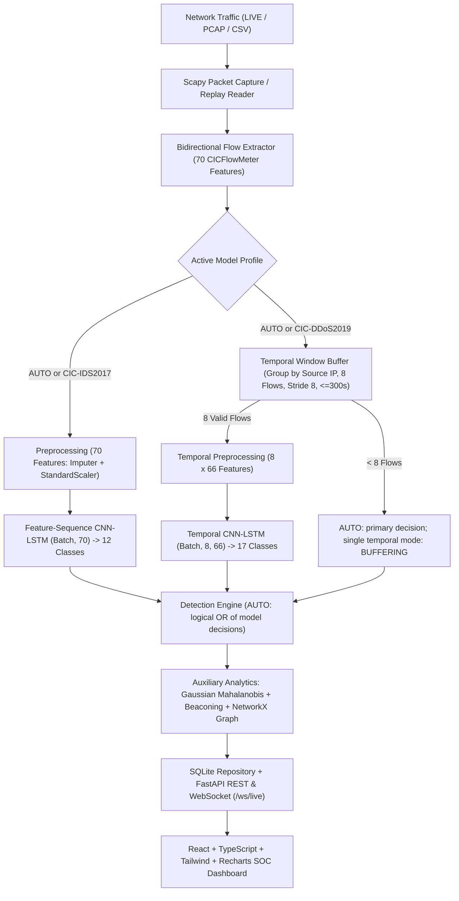

# HỆ THỐNG PHÁT HIỆN TẤN CÔNG MẠNG THEO THỜI GIAN THỰC BẰNG CNN-LSTM

**Đề tài:** Phát hiện tấn công mạng dựa trên mô hình CNN mở rộng kết hợp LSTM (**Giai đoạn 4: Triển khai hệ thống phát hiện tấn công mạng theo thời gian thực**).

Hệ thống **Network Intrusion Detection System (NIDS)** hoàn chỉnh gồm **FastAPI Backend**, **AI Inference Engine (PyTorch TorchScript CPU)**, **Scapy Packet Capture & CICFlowMeter-compatible Flow Extractor**, **SQLite Database** và **React TypeScript SOC Dashboard**, tận dụng trực tiếp hai bộ trọng số **CNN-LSTM** đã huấn luyện trên Google Colab.

---

## 1. Kiến trúc và Hai Model Profile CNN-LSTM



**AUTO (Hybrid Multi-Model NIDS)** là chế độ giám sát mặc định cho LIVE và PCAP_REPLAY. Mỗi flow được CIC-IDS2017 phân loại ngay; CIC-DDoS2019 bổ sung kết quả khi đủ cửa sổ 8 flows hợp lệ cùng Source IP. Nếu một trong hai mô hình dự đoán ATTACK, kết quả hợp nhất là ATTACK. Khi cả hai dự đoán ATTACK, nhãn và điểm số hiển thị lấy từ CIC-IDS2017; nếu chỉ mô hình temporal dự đoán ATTACK, lấy kết quả từ CIC-DDoS2019. Nhật ký lưu cả hai dự đoán và nguồn điểm số. Điểm số giữa các mô hình không được cộng hoặc so sánh trực tiếp. Gaussian và Beaconing tiếp tục là phân tích bổ trợ.

Chế độ AUTO xuất đúng một bản ghi cho mỗi flow đến; kết quả temporal mô tả cửa sổ theo Source IP và được đính kèm khi cửa sổ hoàn thành. Hai chế độ đơn lẻ vẫn dùng được với CSV_REPLAY. Chỉ số offline dưới đây thuộc từng mô hình riêng, chưa phải kết quả đánh giá của AUTO trên tập kiểm thử chung.

| Thông số | Profile 1: `CIC-IDS2017` | Profile 2: `CIC-DDoS2019` (`NIDS_Model_v1`) |
|---|---|---|
| **Kiến trúc** | `FlowFeatureCNNLSTM` (Feature-sequence CNN-LSTM) | `TemporalCNNLSTM` (8-flow Temporal CNN-LSTM) |
| **Kích thước đầu vào** | `(Batch, 70)` — phân loại từng flow | `(Batch, 8, 66)` — cửa sổ 8 flows theo `Source IP` (`stride=8`, $\le 300\text{s}$) |
| **Số lớp phân loại** | 12 lớp (`BENIGN` + 11 nhóm tấn công mạng) | 17 lớp (`BENIGN` + 16 biến thể DoS/DDoS/DrDoS) |
| **Best Epoch** | Epoch 7 | Epoch 22 |
| **Kết quả Test Offline** | Multiclass Accuracy: **94.49%**, Macro-F1: **86.06%** | Binary (BENIGN vs ATTACK) Accuracy: **99.69%** (F1: **99.84%**, FPR: **3.33%**) <br> Multiclass 17-class Accuracy: **55.36%** (Macro-F1: **52.43%**) |
| **Gaussian Threshold** | `263.7635` (Auxiliary Anomaly Score) | `185.0203` (Auxiliary Anomaly Score trên flow cuối của cửa sổ) |

---

## 2. Cấu trúc Thư mục Dự án

```text
NIDS-System/
├── artifacts/
│   ├── CIC-IDS2017/                 # Trọng số cnn_lstm.pt, preprocessor.joblib, gaussian.joblib, metrics...
│   └── NIDS_Model_v1/               # Trọng số cnn_lstm.pt, temporal_preprocessor.joblib, gaussian_temporal.joblib...
├── backend/
│   ├── app/
│   │   ├── main.py                  # FastAPI Server, REST Endpoints & WebSocket /ws/live
│   │   ├── config.py                # Cấu hình hệ thống & tự động nhận diện thư mục artifact
│   │   ├── core/
│   │   │   ├── model_registry.py    # Quản lý & cache 2 profile CNN-LSTM trên CPU
│   │   │   ├── preprocessing.py     # Chuẩn hóa đặc trưng khớp tuyệt đối Colab pipeline
│   │   │   ├── inference.py         # TorchScript forward pass, Softmax, Argmax, Latency
│   │   │   ├── detection_engine.py  # Điều phối CNN-LSTM, Temporal Window, Gaussian, Beaconing, Graph
│   │   │   └── performance_loader.py# Đọc trực tiếp kết quả đánh giá từ artifact Colab
│   │   ├── network/
│   │   │   ├── packet_capture.py    # Scapy AsyncSniffer, PcapReader & CSV Replay
│   │   │   ├── flow_extractor.py    # Bộ trích xuất 70 đặc trưng tương thích CICFlowMeter
│   │   │   ├── temporal_window.py   # Bộ đệm cửa sổ 8 flows theo Source IP cho CIC-DDoS2019
│   │   │   └── sample_generator.py  # Tạo file CSV & PCAP mẫu hợp lệ để kiểm thử nhanh
│   │   ├── analysis/
│   │   │   ├── gaussian.py          # Tính Squared Mahalanobis Distance (Auxiliary Score)
│   │   │   ├── beaconing.py         # Phát hiện kết nối định kỳ nghi ngờ (Suspected Beaconing)
│   │   │   └── graph_analysis.py    # Phân tích đồ thị giao tiếp mạng bằng NetworkX
│   │   ├── api/
│   │   │   ├── monitoring_service.py# Background worker, bounded queue & WebSocket Hub
│   │   │   └── schemas.py           # Pydantic request/response schemas
│   │   └── database/
│   │       └── repository.py        # SQLite persistence với Parameterized SQL
│   ├── tests/                       # Bộ Unit Test & Integration Test (Pytest)
│   ├── requirements.txt
│   └── .env.example
├── frontend/                        # React + TypeScript + Vite + Tailwind CSS + Recharts
│   ├── src/
│   │   ├── components/StatusBadge.tsx
│   │   ├── hooks/useNidsWebSocket.ts
│   │   ├── services/api.ts
│   │   ├── types/nids.ts
│   │   ├── pages/
│   │   │   ├── OverviewPage.tsx         # Trang 1: Tổng quan SOC, Timeline & Phân bố tấn công
│   │   │   ├── LiveMonitoringPage.tsx   # Trang 2: Giám sát LIVE / CSV / PCAP & Trạng thái BUFFERING
│   │   │   ├── AttackHistoryPage.tsx    # Trang 3: Lịch sử cảnh báo SQLite, Lọc, Chi tiết & Export CSV
│   │   │   ├── BeaconingGraphPage.tsx   # Trang 4: Suspected Beaconing & Đồ thị NetworkX
│   │   │   └── ModelPerformancePage.tsx # Trang 5: Hiệu năng mô hình từ Artifact Colab
│   │   └── App.tsx
│   └── package.json
├── docs/
│   ├── FEATURE_MAPPING.md           # Công thức, đơn vị đo và trạng thái kiểm chứng 70 đặc trưng
│   └── DEPLOYMENT.md                # Hướng dẫn cài đặt Windows, Kali Linux & Kế hoạch kiểm thử Lab
├── scripts/
│   ├── start_backend_win.bat
│   ├── start_frontend_win.bat
│   └── start_kali.sh
├── pytest.ini
└── README.md
```

---

## 3. Hướng dẫn Khởi chạy Nhanh (Quick Start)

### Bước 1: Khởi chạy Backend (FastAPI + SQLite + AI Engine)

```powershell
# Tạo môi trường ảo và cài đặt thư viện (nếu chưa cài)
python -m venv .venv
.\.venv\Scripts\pip.exe install -r requirements.txt

# Khởi chạy Backend tại http://127.0.0.1:8000
.\.venv\Scripts\python.exe -m uvicorn backend.app.main:app --host 127.0.0.1 --port 8000
```

### Bước 2: Khởi chạy Frontend (React SOC Dashboard)

```powershell
cd frontend
npm install
npm run dev
```
Truy cập giao diện tại: **`http://127.0.0.1:5173`**

### Bước 3: Chạy bộ kiểm thử tự động (Unit & Integration Tests)

```powershell
# Kiểm thử toàn bộ Backend & AI Pipeline
.\.venv\Scripts\pytest.exe -v

# Kiểm tra kiểu TypeScript và build Production cho Frontend
npm --prefix frontend run typecheck
npm --prefix frontend run build
```

---

## 4. Tài liệu Chi tiết

- [docs/FEATURE_MAPPING.md](file:///d:/NIDS-System/docs/FEATURE_MAPPING.md): Bảng ánh xạ chi tiết 70 đặc trưng mạng CICFlowMeter, công thức tính, đơn vị đo ($\mu\text{s}$, bytes, packets/s) và trạng thái xác thực.
- [docs/DEPLOYMENT.md](file:///d:/NIDS-System/docs/DEPLOYMENT.md): Hướng dẫn triển khai trên Kali Linux, cấu hình `setcap` tối thiểu cho packet capture và kịch bản kiểm thử thực tế trong môi trường Lab.
